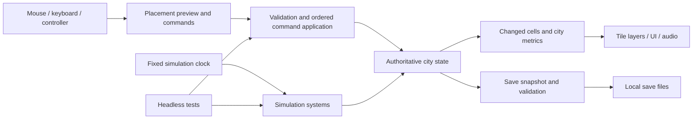

# Technical plan

Status, 5 November 2026: **M0/M1 through M2d implemented and locally tested**; M3a adds one optional project; broader M3 and release work remain proposals. See [Toolchain](TOOLCHAIN.md), [M2d evidence](sessions/2026-11-05-m2d.md), and [Decisions](DECISIONS.md) for the implemented contract and limitations.

## Repository shape

Keep one repository and one Godot project. Create folders when their first contents are needed, rather than scaffolding empty subsystems.

```text
README.md
AGENTS.md
NEXT_SESSION.md
docs/                         # Plans, decisions, and actual session evidence
  TOOLCHAIN.md                 # Exact editor/templates and reproducible commands
  sessions/                    # Milestone results and limitations
game/                          # Implemented Godot project root
  project.godot
  export_presets.cfg
  scenes/                      # Main scene, world view, menus, reusable UI
  scripts/
    sim/                       # Grid, commands, clock, systems, state
    presentation/              # View updates, camera, overlays
    input/                     # Input actions and command construction
    persistence/               # Save validation, migration, file adapter
  content/                     # Authored building definitions and balance values
  assets/                      # Future: runtime art/audio; M1 draws placeholders in code
  tests/                       # Headless runner, model tests, save fixtures
source_assets/                 # Future editable art/audio, outside runtime export
tools/                        # Setup, run/import/test/export, verify, package scripts
licenses/                     # Pinned engine/font notices and placeholder provenance
.github/workflows/             # Deferred CI; no workflow currently configured
builds/                       # Generated exports; ignored
.tools/                       # Optional isolated local tool binaries; ignored
```

Use text `.tscn`, `.tres`, `.gd`, and small structured content files where appropriate. Keep Godot's generated resource UID sidecars and asset import settings that preserve stable references; exclude its `.godot/` cache and generated export output. The implementation agent should check the selected version's metadata rules before writing ignore patterns. Do not blanket-ignore `.uid` or source assets. [Godot version-control guidance](https://docs.godotengine.org/en/stable/tutorials/best_practices/version_control_systems.html).

Use ordinary Git for small source files. Consider Git LFS when large editable art/audio appears; decide before repeatedly committing large binaries, and verify storage/quota arrangements then. Do not place paid SDKs, engine binaries, secrets, signing keys, or private contracts in the repository. Commit shareable export configuration, with credentials kept separately and verified absent from diffs. Exclude tests and editable source art from release exports.

## Keep the simulation independent of the scene



`sim/` may use Godot data types and `RefCounted`, but should not require a viewport, camera, input device, audio player, or active SceneTree. It still requires the Godot runtime; it is not an engine-independent library. The renderer observes state and never becomes the source of truth. UI actions use the same command validation as tests.

### State and commands

- Grid dimensions and bounds are explicit. Use integer cell coordinates and flat arrays indexed by `y * width + x` for terrain, land use, and relevant values. Start at 64x64, with 128x128 the release planning ceiling.
- Terrain and occupancy are distinct. A road cannot coexist with a zone/building on the same cell unless a future rule explicitly permits it. Start with single-cell logical lots and facilities; larger footprints require their own validation tests before adoption.
- Give buildings/content stable semantic IDs independent of scene paths and sprite-atlas coordinates. Persist development levels, service-loss counters, treasury, last-settlement inputs, clock, content/schema versions, and deterministic random state. Population, jobs, demand, and network allocation are derived.
- Money uses bounded integer smallest units. Growth decisions use integer/fixed-point values where practical; visual animation can use floats.
- Commands include place road, zone, place facility, demolish, and change policy. Sort/deduplicate cells in a stroke. Validate terrain, bounds, conflicts, and total affordability before applying anything. A rejected stroke changes neither funds nor the map.
- Repainting an identical land use is a no-op and costs nothing. Demolition never removes underlying terrain. Clear/removal and refund rules must be explicit; M1 may use no demolition refund.
- Apply commands in recorded order at a defined command boundary. Commands also apply while paused, without advancing simulated time. Record tick and sequence number so replay has an unambiguous order.

### Clock and system order

Provisional calendar: one simulation tick is one game day; 30 days form an accounting month. Default speed advances one tick per real second, with pause and 3x fast speed. These are balancing defaults, not an imitation of the reference game's timing.

Render frames and simulation advancement are separate. Changing framerate must not change results for an identical tick/command sequence. After a stall, limit catch-up work per frame without changing logical tick order; do not simulate an offline absence on startup. Pause when focus is lost by default.

Proposed order for each tick:

1. Apply pending commands in sequence and update network changes.
2. Compute road reachability and power availability.
3. Update amenity/nuisance effects and demand inputs from the prior completed state.
4. Evaluate bounded growth/decline changes, then apply them together.
5. Recalculate city totals and, at the month boundary, income/upkeep.
6. Evaluate project progress and emit changes/diagnostic reasons for presentation.

The six-system order remains a later proposal. M2d increments each day separately, runs aggregate growth on multiples of five, then settles budgets on multiples of 30; commands apply synchronously at input boundaries and record tick/sequence. It processes at most eight ticks/frame and retains a maximum of one simulated hour of backlog. Time beyond that explicit extreme-stall cap is discarded. Tests cover 90-second frame partitioning, draining retained backlog, and overflow safety. Focus loss and dialogs suspend active time.

Document boundary cases before coding each system. Avoid reading partially updated neighbours during a growth sweep. Iterate in a stable order, use an explicit seeded generator, and separate cosmetic randomness from simulation randomness. Replays are guaranteed only for a specified simulation/content/engine version unless cross-version compatibility is deliberately implemented and tested.

### Small simulation before realism

**Implemented in M2a:** `sim/road_access.gd` derives one outside root from immutable terrain: east-edge midpoint on seeded maps, nearest boundary land with row-major tie-break on other valid saves. No boundary land means no link, with an explicit explanation. A road must occupy the root; orthogonal flood fill marks reachable roads and their side-adjacent home plots. Homes do not relay service. Other boundary roads are not roots.

`City.rebuild_derived()` runs at initialization, validated load, and after every successful occupancy-changing command (including home edits). Full bounded recomputation updates both arrays synchronously, so neither UI nor a subsequent command can see stale access. Rejected/no-op commands and previews do not rebuild or alter it; ticks do not touch topology. The iterative queue has fixed neighbour order and no RNG/scene dependency. Terrain fixture edits must explicitly rebuild. Reachability is derived and absent from snapshots.

The renderer shows an original gold flag inside the root tile and optional plus/minus access marks. A separate inspector explains each home state and reports development, demand, next growth check, and service-loss grace in M2c. Home returns the camera to the link; R toggles marks. Text widths are established before first layout to avoid native autowrap inflation. Small loaded maps are centered rather than clamped with inverted bounds.

**Implemented in M2b:** `sim/power_grid.gd` labels power networks: road and power-station tiles joined by shared sides, in row-major order with iterative flood fills. Stations relay power but not road access, and power does not need the outside link. Each station adds 20 units; every home/shop/workshop plot requests 1, regardless of development.

A multi-source search gives every network tile its distance from the nearest station. Plots touching a sourced network are served nearest-first by (distance, row-major index). Each takes a unit from the touching network with room that has the smallest (distance, network order); the rest are short of capacity. Reasons distinguish powered, shortage, disconnected, no road/station beside the plot, and no station built.

`City.rebuild_derived()` rebuilds access, power, then growth totals/eligibility at initialization, validated load, and after every successful occupancy-changing command. Network allocation is never serialized or changed by ticks. Growth rounds refresh only their totals/eligibility; no RNG is consumed. A headless 128×128 striped rebuild took about 71–78 ms locally, which is acceptable per command but not per frame.

The renderer adds an original station glyph and bolt/× marks (E). The inspector keeps road access and power on separate lines within a fixed 320 px panel. There is no allocation memory, so a newly zoned nearer plot can displace a farther one; D23 deliberately retains this policy for grown buildings, with gradual decline after lost service.

**Implemented in M2c:** `sim/growth.gd` derives population, jobs, demand, and a next-round plan from the completed city. Home/shop/workshop levels 0-2 are persistent. Each home level holds 4 residents; shop/workshop levels provide 2/4 jobs. Starter demand allows three home levels before jobs exist. Home target = min(2 x cells, 3 + floor(jobs/2)); both business targets = ceil(population/16). Demand is the positive remaining level count. Every fifth tick reserves up to eight additions per type, with covered homes first then row-major ties (D26), only for powered/access-served plots below level 2. It applies all changes together. Missing services lose one level on every second growth check; restoring both resets the saved loss counter immediately. Demand satisfaction alone never causes decline. Counts describe standing development until decline, not individual employment. See D22-D24 for exact bounds and save validation.

**Implemented in M2d:** `sim/economy.gd` calculates integer monthly income/upkeep from post-growth serviced residents/jobs and all facility counts. `last_budget` retains actual settlement inputs; forecasts are derived. Cash has an explicit zero-floor waiver and maximum-cap report, without debt or service cuts. `sim/amenity.gd` rebuilds non-stacking Manhattan-radius-3 coverage with bounded local scans. Covered homes get priority within existing demand/caps, not extra demand. D25-D27 specify the exact rules. No RNG is consumed. Nuisance remains unimplemented. M3a adds derived eligibility and explicit one-time project completion; it adds no tick stage or economic/growth effect. Schema 5 stores only completed status and its park anchor, retaining historical completion after the anchor is cleared.

## Presentation and controls

M1 uses one `Node2D` drawing only visible geometric cells, plus a `SubViewport` and full-window UI. There are no imported sprite assets or per-cell processing Nodes. This is a deliberate simplification from the original `TileMapLayer` plan. Consider atlas/layer presentation when actual art and profiling warrant it; keep decorative movement independent from authoritative state.

The M0 display experiment should use a 640x360 world SubViewport at integer scale, with a full-window Control layer for independently scalable UI. Letterbox the world as necessary. Test input-to-cell mapping through that viewport, camera movement, UI occlusion, and zoom. Integer scaling is supported by Godot, but correct pointer transforms still need a real test. [Godot resolution guidance](https://docs.godotengine.org/en/stable/tutorials/rendering/multiple_resolutions.html).

The display matrix is 1280x720, 1366x768, 1920x1080, and 1280x800, including Windows display scaling. M1 automated geometry/picking checks cover those four sizes at 16/18/20-pixel interface text; native visual checks cover the first, second, and fourth. The complete 1080p native frame exceeded the capture surface. Windows DPI variants remain unverified. Interface settings/camera are not persisted yet.

Define named input actions rather than hard-coded device checks. Pointer and grid-cursor controls should produce the same commands. Controller menus need explicit focus, visible selection, consistent confirm/cancel, and prompts for the active input. Mouse/keyboard-only is acceptable for M1; complete controller access, including save naming or sensible default names, is a gate for M3's controller claim.

## Saves are a first-class feature

Keep saves under a stable, neutral Godot `user://` location; do not tie their path to a changing marketing title. Separate user preferences from city state. Save data is plain validated data, not scripts or user-loadable Godot resources.

Start with readable JSON for this small model. Include a schema version, simulation/content version, dimensions, seed, random state, tick, treasury, cells, buildings, and project state. Store 64-bit random-state values as strings or another lossless representation; do not assume a JSON number preserves every 64-bit integer. Use bounded integral checks on numeric fields.

Load into temporary model data, validate size limits, counts, IDs, ranges, and consistency, then replace the live city only after success. Unknown newer schemas and corrupt files produce an understandable message and leave the current city intact. Never overwrite the source file just by attempting a load.

Write to a temporary file in the same directory, close and validate it, retain the last good backup, and use the strongest safe replacement supported by the platform. Describe this as best-effort crash resilience, not an untested guarantee of filesystem atomicity. Test interrupted/failed writes and backup recovery. Autosaves should rotate rather than overwrite the only copy.

Save schema versioning is separate from game versioning. During prototypes, document any intentional incompatibility. Before a public demo, establish fixture-based migration tests for every supported schema, preserve an original copy during migration, and set a stated compatibility policy.

M2d game version `0.5.0-m2d` uses **schema 4, simulation/content `m2d-1`**. IDs 0–5 retain their meanings; 6 is a park. Development/loss arrays retain exact-length/bounds/consistency validation. A strictly validated `last_budget` dictionary stores the most recent settlement inputs; outputs are derived. Schema 3 retains development/loss; schemas 1/2 gain zero arrays; all older formats retain prior authoritative values, gain empty budget history and incur no retroactive settlement. Loading never writes.

Before an older primary or backup is replaced, exact bytes are preserved once as `manual.schema1.json`, `manual.schema2.json`, or `manual.schema3.json`. Failed preservation prevents replacement. Five fixtures are hash-checked, including pending decline and a fractional month boundary. Future persistent rules need explicit version and migration decisions.

## Verification and performance

Use a minimal headless GDScript runner first; a third-party test framework is optional if it provides clear value and has a pinned, reviewed licence. The runner must return a failing exit code on failure. Tests should verify player-facing invariants, not merely repeat implementation steps.

| Area | Meaningful checks |
| --- | --- |
| Commands | Bounds/water/conflict rejection, unaffordable atomic stroke, no double charge, no mutation on failure, deterministic command order |
| Networks | Diagonal cells do not connect; road removal splits service; reconnection restores service; isolated sources stay isolated |
| Simulation | Same seed/commands/ticks yield same canonical state; pause and render-rate changes do not alter tick results; quantities stay in range |
| Economy | A basic town can grow; accounting matches specified income/upkeep; deficits have the documented recovery route |
| Persistence | Round trip, continuation after reload, truncated/invalid/newer saves, lossless random state, failed-write backup handling |
| Export/UI | Actual exported executable launches on a clean profile; build/inspect/save/load works; no mouse events paint through UI |

For deterministic checks, compare canonical model data, not screenshots or incidental JSON key order. Test some hand-constructed cases with known outcomes as well as seeded runs.

Initial performance targets are hypotheses: smooth 60 fps at 1080p on a recorded representative desktop, responsive placement within roughly 100 ms, and no sustained hitching from a 128x128 occupied city at fast speed. Aim for simulation work below 8 ms at the 95th percentile per tick, and a save operation below one second. Record CPU/GPU/RAM, engine, build, map, timings, and exclusions before claiming any target passed. The present development machine's RAM alone does not establish minimum requirements.

Measure a busy-city fixture and a 30-minute soak before beta. If performance is inadequate, profile update frequency, allocations, full-map redraws, and graph recalculation before adding threads. If a Deck release is considered, test the device separately and check the current [Steam hardware compatibility requirements](https://partner.steamgames.com/doc/steamhardware/compat).

## Implemented command contract

Use the helpers documented in [Toolchain](TOOLCHAIN.md), which resolve and verify the isolated pin. These commands were exercised during implementation:

```powershell
.\tools\project.ps1 Import
.\tools\project.ps1 Test
.\tools\project.ps1 Run
.\tools\verify.ps1
.\tools\package.ps1
```

The export preset and output directory must exist, and templates must match the editor. A headless import alone does not prove that every gameplay script or scene works: load the relevant scripts/scenes in checks and run the exported game. [Godot command-line documentation](https://docs.godotengine.org/en/stable/tutorials/editor/command_line_tutorial.html).

CI remains deferred until the initial source baseline and remote workflow are adopted. Then add import, meaningful tests, and a Windows export using the existing local helpers. Pin action/tool versions, give jobs minimum permissions, and produce build metadata/checksums. CI should create reviewable artifacts; public uploads and release promotion remain a separate authorised action. Do not introduce a backend, Docker requirement, or deployment service for this offline desktop game.
